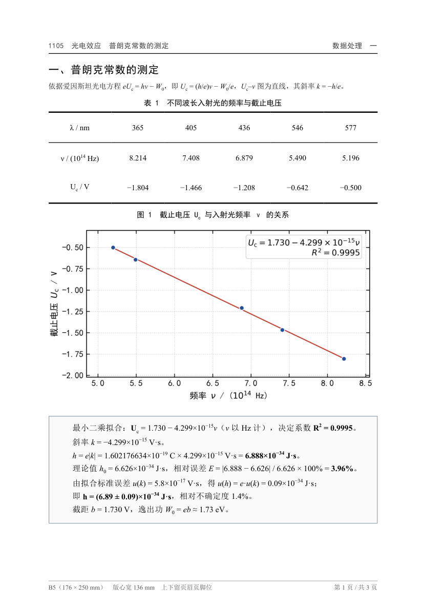

# lab-report-b5

把实验原始数据变成**可直接打印、裁剪、粘贴**的 B5 数据处理页：三线表、定尺寸插图、
拟合表达式与 R²、完整的误差计算，一次生成若干页 PDF，并自动校验版面是否合格。

适合大学物理实验这类「数据不多、图表固定、要求排版规范」的报告页。



## 特性

- **B5 精确排版**：176 × 250 mm，左右 20 mm 页边距，版心 136 mm，打印不缩放。
- **三线表**：表头细分隔线，支持左右双区并列的宽表。
- **定尺寸出图**：按毫米出图，图内字号即打印字号。
- **数字不手抄**：结果由脚本写入，正文用占位符引用，缺值直接报错。
- **自动验收**：回读浏览器渲染结果，检查宽高比、图尺寸、溢出与页数。

---

# 用 AI agent 使用（推荐）

这是最省事的方式：你提供原始数据和「要什么」，agent 负责写计算、调版式、跑检查、交付 PDF。

## 第 0 步：确认环境（一次性）

1. 安装依赖：

   ```bat
   cd 安装路径\lab-report-b5
   python -m pip install -r requirements.txt
   ```

2. 电脑上有 Chrome 或 Edge 即可（一般自带，脚本自动查找）。
3. 跑一遍自带示例，确认环境正常：

   ```bat
   python build.py examples\1105-photoelectric
   ```

   看到各项 `[ok]`、末尾给出 PDF 路径，说明环境没问题。

## 第 1 步：建一个独立的实验目录

每个实验一个目录，不要和其他实验混放：

```
<实验目录>\
├─ 原始数据-1.jpg
├─ 原始数据-2.jpg
├─ data.json      ← 从 templates\data.template.json 复制
└─ calc.py        ← 从 templates\calc.template.py 复制
```

> 也可以直接让 agent 建：说「在这个空目录里用 lab-report-b5 的模板建好文件」。

## 第 2 步：放原始数据

把照片（或整理好的数字）放进实验目录，文件名带序号，并在指令里说明
**哪份数据对应报告的第几部分**。照片尽量清晰、平整、不缺页。

## 第 3 步：给 agent 下指令（最关键）

只给一句「帮我排版」通常不够——agent 不知道要画什么图、拟合什么、算什么量。
把下面这些说清楚，产出质量差别很大：

| 必须交代 | 示例 | 为什么 |
|---|---|---|
| 实验名称 / 页眉 | 1105 光电效应 普朗克常数的测定 | 决定页眉与文件名 |
| 数据对应关系 | 数据-1 是第一部分，数据-2 是第二部分 | 避免张冠李戴 |
| 每部分要什么 | 表格几列、画什么关系图、拟合什么模型 | 决定 `calc.py` 写什么 |
| 要计算的物理量 | 求普朗克常数 h，并与理论值算相对误差 | 决定结果框内容 |
| 版式要求 | B5、三线表、图占版心宽、每页不溢出 | 不写就走模板默认值 |
| 特殊约定 | 有效数字、单位、表格编号从 1 开始 | 减少返工 |

### 指令模板（可直接改）

> 用 `lab-report-b5` 处理这个实验。
>
> **实验名称**：1105 光电效应 普朗克常数的测定
> **数据文件**：`原始数据-1.jpg`（第一、二部分）、`原始数据-2.jpg`（第二部分续表、第三部分）
>
> **第一部分**：不同波长 λ 对应的频率 ν 与截止电压 U_c。
> 做一个横版表（宽高比 3~5），画 U_c–ν 关系图（16:9），线性拟合给出表达式和 R²，
> 由斜率求普朗克常数 h，与理论值 6.626×10⁻³⁴ J·s 比较算相对误差，并给出拟合斜率的标准差。
>
> **第二部分**：两种波长下的 I–U_AC 数据（各约 40 组）。
> 表格左右两区各 3 列（U、I₁、I₂），画两条 I–U 曲线并加图例，
> 由高压段趋势估计两种波长各自的饱和光电流。
> 表和图都占满版心宽，两者加起来略矮于一页。
>
> **第三部分**：不同光阑孔径的饱和电流、不同照射距离的饱和电流。
> 两张小表 + 一张 I–L⁻² 拟合图（16:9），给出拟合式和 R²。
>
> **版式**：B5、左右 20 mm 页边距、三线表；每页内容不得溢出；输出 PDF。

数据是手写或扫描件时，建议再加一句（可选）：

> 先把识别出的数字列出来给我确认，确认后再排版。

## 第 4 步：审阅与迭代

agent 会自己跑构建、读检查结果、调尺寸，但**数字和物理结论必须你把关**：

1. 数据有没有录错（涂改、单位、量级）；
2. 拟合模型是否合理（该线性时别做成指数）；
3. 结论句与数据是否一致；
4. 打开 PDF 翻一遍，看表线、图例、题注、页脚。

发现版式问题直接说「第 2 页底部超了」「图 3 太矮」，它知道该改哪个参数。

## 第 5 步：拿到成品

PDF 在实验目录的 `out/` 下，文件名由 `data.json` 的 `name` 决定。
按 B5 打印，或打印后裁剪粘贴到报告本上。

## agent 内部会做什么

1. 读 `SKILL.md` 与 `references/page-geometry.md`，确认版式规范；
2. 读原始数据，录入 `calc.py`；
3. 写计算、出图，结果写入 `out/out.json`；
4. 在 `data.json` 里组织表、图、结果框；
5. `python build.py <实验目录>`，生成 PDF 并自动检查；
6. 检查不过就调行高/图高，回到第 5 步，直到全部 `[ok]`；
7. 渲染 PNG 目检，交付并汇报关键结果。

## 注意事项

- **别让 agent 改验收门槛**：`check.py` 里的宽高比、237 mm 上限是打印安全线，
  把数值改大只是让检查「通过」，打印时照样被裁。
- **数字只在 `calc.py` 里改**：`out/out.json` 是生成物，重跑会覆盖。
- **原始数据先核对**：照片识别错误是返工的第一大原因。
- **一个实验一个目录**：混放会导致图片和 `out.json` 互相覆盖。
- **保留 `out/`**：以后改数据或换参数，直接重跑，不用重新搭。
- **以 PDF 为准**：浏览器预览与打印可能有细微差异，验收看 PDF。

## 常见问题

**PS: 下述问题如果自己不会操作一般可以直接让 AI agent 帮你解决。**

**Q：第一次用，怎么判断环境能不能跑？**
先跑自带示例 `python build.py examples\1105-photoelectric`，全 `[ok]` 即可。

**Q：提示「版面不合格，请调整 rowHeightMm / heightMm」怎么办？**
看对应那一行：宽高比越界就调表格行高；内容底部超限就减行高、删空行或缩短说明。
改 `data.json` 后重跑，通常一两轮就好。

**Q：提示找不到 Chrome / Edge？**
装一个即可；已有的用 `--browser "路径\chrome.exe"` 指定，或设环境变量 `LAB_REPORT_BROWSER`。

**Q：表格行数太多，一页放不下？**
减小 `rowHeightMm`（每次 0.2 mm），或拆成左右两个区（`dividerAfter`）。
示例里 22 行 × 6 列的表就是靠 4 mm 行高放进一页的。

**Q：想改字体、字号、线宽？**
改 `styles/page.css` 与 `references/page-geometry.md`，重跑构建；
检查项按几何尺寸算，改字号不影响通过，但要自己确认是否拥挤。

**Q：图必须是 16:9 吗？**
不必。`aspect` 可写 `"3:2"`、`"2:1"`，或用 `heightMm` 指定高度；
宽度建议保持 136 mm（满版心），否则打印出来偏小。

**Q：页眉、题注、编号要改？**
都在 `data.json`：`header`、`caption`、`title` 改文字，编号是手写的，按需调整。

**Q：没有 Python 环境，只想要排版参考？**
用 `references/page-geometry.md` 的尺寸在 Word/LaTeX 里手排，字号、行距、线宽、图宽高比都有具体数值。

**Q：扫描件是手写的，agent 识别不准？**
要求它先把数字列出来给你确认再排版，能省掉大量返工。

---

# 不用 agent：命令行使用

自己写 `calc.py`、自己改 `data.json` 时，流程是三步：

1. **填数据**：在 `calc.py` 顶部录数组，写拟合与误差，把结果写进 `out/out.json`；
2. **配结构**：在 `data.json` 里写表头、列宽、行高、图尺寸、题注；
3. **构建**：`python build.py <实验目录>`。

完整示例见 `examples/1105-photoelectric/`，它复现了 3 页成品。

## data.json 参考

页面字段：`name`（PDF 文件名）、`paper`（纸张与页边距）、`footerLeft`（页脚左字）、
`pages[]`（每页的 `header`、`title`、`blocks`）。

块类型：

| `type` | 主要字段 | 说明 |
|---|---|---|
| `table` | `caption`、`header`、`rows` 或 `rowsFrom`、`rowHeightMm`、`colWidthsMm`、`dividerAfter`、`minAspect`/`maxAspect`、`layout` | 三线表；`layout:"quantities"` 表示首行是量名；`dividerAfter:3` 在第 3 列后加竖线（双区表）；大表用 `rowsFrom` 引 `out.json` 数组 |
| `figure` | `src`、`caption`、`widthMm`、`aspect` 或 `heightMm` | 图片相对 `out/` 目录 |
| `result` | `lines[]` | 灰底结果框 |
| `note` | `text`、`style` | 说明文字 |
| `spacer` | `heightMm` | 垂直留白 |

大表用 `rowsFrom`，让原始数据只在 `calc.py` 写一次：

```json
{ "type": "table", "id": "t2", "rowsFrom": "rows_t2", "header": ["..."], "rowHeightMm": 4 }
```

表头可带第二行小字：

```json
{ "t": "I<sub>1</sub> / (10<sup>&minus;11</sup> A)", "sub": "&lambda; = 435.8 nm" }
```

## 检查输出怎么看

```
[ok] t1     136.0 x 38.0 mm，宽高比 3.58（需 3~5）
[ok] fig1   136.0 x 76.5 mm（目标 136.0 x 76.5）
[ok] 第 2 页内容底部 229.6 mm（上限 237.0）
```

`[!!]` 有三类：宽高比越界 → 调行高/列宽；尺寸不符 → `calc.py` 出图尺寸与声明不一致；
内容底部超限 → 减内容。改完重跑即可。

---

# 目录结构与环境

```
lab-report-b5/
├─ build.py            构建：calc.py → HTML → PDF → 检查
├─ build.bat           Windows 双击运行
├─ check.py            版面测量与校验
├─ figstyle.py         按毫米出图的 matplotlib 样式
├─ render_pages.py     PDF 转 PNG，便于目检
├─ styles/page.css     B5 几何与三线表样式
├─ templates/          data.json 与 calc.py 空白模板
├─ references/         排版规范、已知坑、指令模板
├─ examples/           完整示例（3 页成品）
├─ SKILL.md            给 agent 的流程与验收标准
└─ requirements.txt
```

- 系统：Windows（Chrome 或 Edge 任一即可）
- Python 3.9+，依赖 `numpy` / `matplotlib` / `scipy` / `pymupdf`
- 字体：SimSun、SimHei（Windows 自带）
- macOS / Linux：把 `styles/page.css` 与 `figstyle.py` 里的字体换成
  `Songti SC` / `Noto Serif CJK SC` 等等价字体即可，其余流程不变

## 作为 skill 安装（可选）

把整个目录放到 agent 的 skill 扫描目录下，即可用一句话唤起：

```
<项目>/.agents/skills/lab-report-b5/SKILL.md
或用户目录：~/.dsh/skills/lab-report-b5/SKILL.md
```

`SKILL.md` 已含 frontmatter，`templates/`、`references/`、`examples/` 会按需读取。

## 分享与维护

- 仓库：<https://github.com/resstifnurv/lab-report-b5>（Releases 里也有打包好的 zip）。
- 打包：压缩整个目录，可先删各示例的 `out/pages/`。
- 版本：git 管理，一学期冻结一次版式；新实验只往 `examples/` 加，不改样式。
- 改样式时同步更新 `references/page-geometry.md` 与 `SKILL.md` 的验收标准，避免「样式改了、检查没改」。

## 许可

内部教学使用，可自由修改。